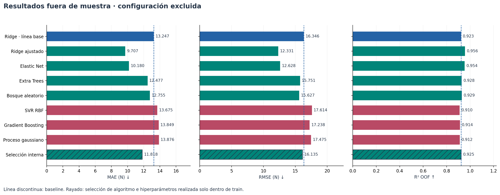

# Predicción de primera falla · Modelos ajustados

**[Abrir notebook 05 — modelos, ajuste y evaluación](notebooks/05_Modelos_Ajustados.ipynb)**

[Enlace para compartir](https://github.com/melissaaylasb-sudo/T02_MIA14_SeccionB/blob/codex/modelos-ajustados/notebooks/05_Modelos_Ajustados.ipynb) · [Etapa anterior: ingeniería de características](notebooks/04_Feature_Engineering_Pantograficas.ipynb)

Melissa Dessire Aylas Barranca · UNI · Maestría en Inteligencia Artificial.

Estimar, a partir de la geometría previa al ensayo, la **fuerza en newtons de la primera rotura de una fibra o un pivote**. Se compara el Ridge de referencia con regresores ajustados mediante validación cruzada anidada. El desarrollo, las imágenes y la interpretación están en el notebook.

| Elemento | Especificación |
|---|---|
| Entrada | Número de celdas en Y; altura, ancho, longitud y volumen de fibras; altura, radio, cantidad y volumen de pivotes; volumen CAD del espécimen. |
| Target | `First_Failure_Load_N`: carga medida en la primera falla, en N. |
| Salida | Estimación numérica de esa fuerza; se evalúa el error frente a la medición experimental. |
| Variables | Geometría original A, igual que el baseline. El radio constante se filtra dentro de cada entrenamiento. [Diccionario y unidades](docs/diccionario_features.md#variables-de-esta-etapa). |
| Referencia | Ridge con parámetros fijos del experimento anterior; sus predicciones se vuelven a calcular y se contrastan con las publicadas. |
| Modelos ajustados | Ridge, Elastic Net, SVR con núcleo RBF, Random Forest, Extra Trees, proceso gaussiano y Gradient Boosting. |
| Selección del algoritmo | Se incluye un selector que elige con la validación **interna**, sin usar los errores del grupo externo. |

## Resultado ejecutado

| Procedimiento | MAE configuración [N] | RMSE configuración [N] | R² configuración | MAE familia [N] |
|---|---:|---:|---:|---:|
| Ridge · baseline | 13.247 | 16.346 | 0.9226 | 57.637 |
| Ridge ajustado | 9.707 | 12.331 | 0.9559 | 67.769 |
| Elastic Net ajustado | 10.180 | 12.628 | 0.9538 | 58.214 |
| Selección interna de algoritmo | 11.818 | 16.135 | 0.9246 | 72.089 |

**Ridge ajustado redujo el MAE un 26.72 % frente al baseline** al excluir configuraciones. Es el menor MAE observado entre los algoritmos comparados. La selección interna evalúa por separado la elección automática del algoritmo. Al excluir familias completas, ninguno de los modelos ajustados mejora el baseline; la transferencia a arquitecturas nuevas sigue sin resolverse.

[Tabla completa de métricas y tiempos](reports/modelos_ajustados/metricas_resumen.csv) · [Verificación de la ejecución](reports/modelos_ajustados/verificacion.json)



## Protocolo de comparación

| Requisito | Implementación verificable |
|---|---|
| Split correcto | Se reutilizan exactamente los casos de train/evaluación de la Semana 5: LeaveOneGroupOut por configuración nominal; comprobación adicional dejando fuera una familia Y completa. |
| Ajuste de hiperparámetros | GridSearchCV dentro de cada train externo. GroupKFold de cinco particiones por configuración; LeaveOneGroupOut por familias para la comprobación adicional. |
| Fit solo en train | Contrato de entradas → imputación por mediana → geometría A → filtro de constantes → estandarización → regresor. Se ajusta el pipeline completo también en cada partición interna. |
| PCA / target encoding | No forman parte de este experimento. Las entradas son numéricas y no se incorporan transformaciones aprendidas fuera del pipeline. |
| Semillas | 42 en algoritmos aleatorios. Las particiones de grupos son deterministas. Versiones, parámetros y semillas quedan registrados. |
| Datos constantes | Misma tabla curada, mismo target y mismos casos en todos los modelos. SHA-256 comprobado antes y después; sin nuevos datos, eliminación de casos ni imputación del target. |
| Logs | Configuración congelada, resultados de todos los candidatos, parámetros por partición, predicciones, tiempos, avisos y fechas UTC. |

El ajuste interno es la incorporación nueva; **la evaluación externa conserva las particiones anteriores**. La selección interna minimiza el MAE promedio entre particiones; las métricas externas se calculan reuniendo las predicciones fuera de muestra. La clasificación por menor error externo es descriptiva: no reemplaza la evaluación del selector interno.

## Métricas e imágenes

| Métrica | Qué indica |
|---|---|
| **MAE [N]** | Error absoluto promedio; criterio principal. Menor es mejor. |
| RMSE [N] | Error con mayor penalización de desviaciones grandes. Menor es mejor. |
| MedAE [N] | Mediana del error absoluto; describe el error central. |
| R² fuera de muestra | Variación explicada respecto a la media del conjunto evaluado; puede ser negativo. No es un porcentaje de exactitud. |
| Mejora frente al baseline [%] | 100 × (MAE baseline − MAE modelo) / MAE baseline. Un valor negativo significa deterioro. |
| Tiempo [s] | Búsqueda, reajuste y predicción medidos; depende del equipo. No equivale a latencia de una aplicación. |

El notebook incluye comparación de métricas, observado frente a predicho, residuales, errores por familia, diferencias por partición y resultados de la búsqueda. Los modelos que no mejoren también permanecen en la comparación.

## Estructura del proyecto

```text
notebooks/
  01_Ingesta_Curaduria_y_Calidad.ipynb
  02_EDA.ipynb
  03_Transformaciones_Exploratorias.ipynb
  04_Feature_Engineering_Pantograficas.ipynb  # Experimento previo, conservado
  05_Modelos_Ajustados.ipynb                 # Entrega de esta rama
src/
  feature_engineering.py   # Contrato geométrico y pipeline compartido
  ajuste_modelos.py        # Búsqueda anidada y predicciones de evaluación
  verificar_ajuste.py      # Grupos, estadísticas train, hashes y métricas
  reporte_ajuste.py        # Gráficos y ejecución del notebook 05
config/
  ajuste_modelos.json      # Modelos, rangos, semillas y protocolo congelado
reports/
  feature_engineering/    # Referencia histórica: splits y resultados
  modelos_ajustados/
    metricas_resumen.csv  # Comparación común de errores y tiempos
    predicciones_oof.csv  # Fuerza observada y predicha fuera de muestra
    metricas_folds.csv    # Resultados y parámetros por grupo reservado
    busquedas.csv         # Todos los candidatos de la validación interna
    figures/              # Gráficos PNG y SVG
    auditoria_train.json  # Estadísticas aprendidas en entrenamiento
    particiones_internas.json
    manifest.json         # Fechas, versiones e integridad
    ejecucion.jsonl       # Registro de ejecución
    verificacion.json    # Comprobaciones independientes
    config_ejecutada.json  # Copia de la configuración ejecutada
    particiones_externas.json  # Copia exacta de los splits anteriores
    seleccion_interna.json    # Algoritmo elegido solo con train
    logs_ajustes/         # Cada fit, validación, aviso y timestamp
  semana_6/               # Informe anterior; esta entrega es el notebook
config/feature_engineering.json  # Especificación del baseline anterior
data/processed/preliminary/model_table.csv  # Snapshot fijo compartido
requirements-modelos-ajustados.txt          # Versiones de esta ejecución
tests/test_ajuste_modelos.py                # Pruebas de aislamiento
```

## Reproducir

Desde la raíz del repositorio, en un entorno virtual con Python 3.13:

```powershell
python -m pip install -r requirements-modelos-ajustados.txt
python -m src.ajuste_modelos --output reports/modelos_ajustados_repeticion
python -m src.verificar_ajuste --run-dir reports/modelos_ajustados_repeticion
python -m pytest tests/test_ajuste_modelos.py -q
```

Para volver a ejecutar las celdas y gráficos sobre los resultados publicados: `python -m src.reporte_ajuste --execute`.

La ejecución del entrenamiento exige una carpeta de salida nueva para conservar la evidencia anterior. El notebook permite revisar la ejecución publicada y activar una repetición independiente; ambos modos se identifican explícitamente.

**Alcance:** el EDA previo ya examinó este conjunto. La separación de entrenamiento y evaluación evita reutilizar el grupo reservado durante el ajuste, pero no convierte los resultados en una validación externa. La prueba por familias muestra el comportamiento ante arquitecturas ausentes del entrenamiento.
