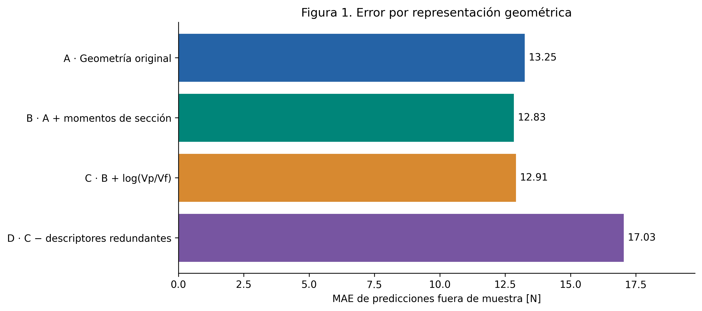
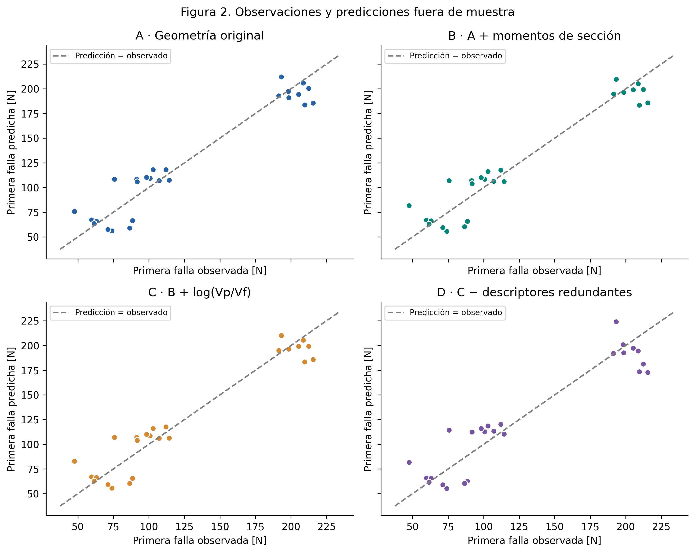
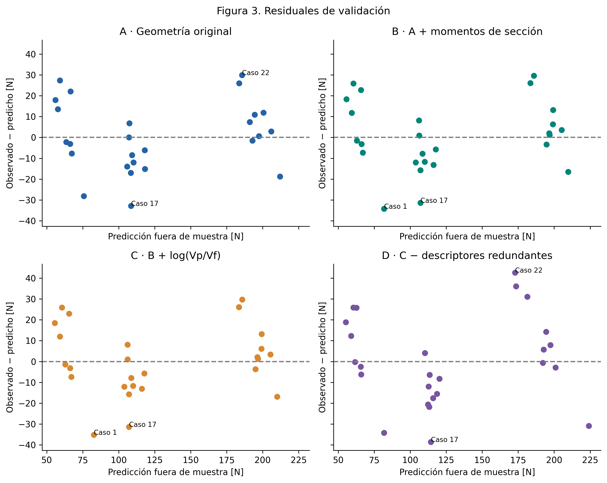
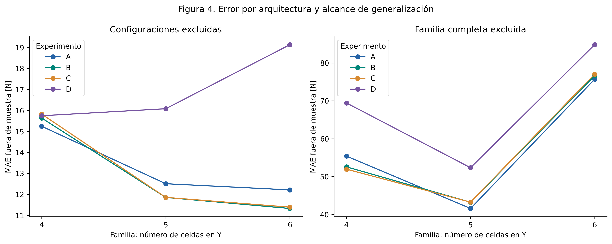
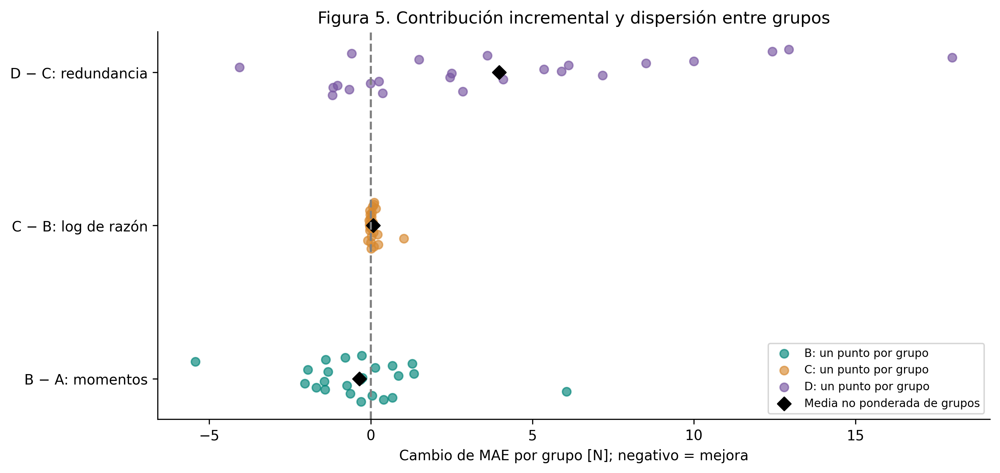

# Experimentos de ingeniería de características

El menor MAE del protocolo principal corresponde a **B**, con **12.8346 N**, frente a **13.2466 N** de A; reducción descriptiva de **3.11 %**. Al excluir familias completas, el MAE de B es **57.6538 N**. El ganador entre variantes examinadas no constituye una estimación independiente del rendimiento de un modelo seleccionado.

## Comparación principal: configuración nominal excluida

| experimento | feature_set | MAE_N | RMSE_N | MedAE_N | R2_OOF | delta_MAE_vs_A_N | cambio_MAE_vs_A_pct | tiempo_s | n_features_min | n_features_max | decision |
| --- | --- | --- | --- | --- | --- | --- | --- | --- | --- | --- | --- |
| Dummy | Media del entrenamiento | 56.3090 | 61.7164 | 61.3584 | -0.1036 | 43.0625 | 325.0844 | 0.2326 | 9 | 9 | Referencia ingenua |
| A | A · Geometría original | 13.2466 | 16.3457 | 11.9409 | 0.9226 | 0.0000 | 0.0000 | 0.2458 | 9 | 9 | Baseline |
| B | B · A + momentos de sección | 12.8346 | 16.2029 | 11.7801 | 0.9239 | -0.4119 | -3.1097 | 0.5031 | 11 | 11 | Mantener en evaluación |
| C | C · B + log(Vp/Vf) | 12.9139 | 16.3271 | 11.8643 | 0.9228 | -0.3327 | -2.5115 | 0.5809 | 12 | 12 | Descartar |
| D | D · C − descriptores redundantes | 17.0350 | 21.1361 | 14.9109 | 0.8706 | 3.7884 | 28.5992 | 0.6350 | 9 | 9 | Descartar |

Tiempo en segundos de ajuste y predicción acumulados. ΔMAE y cambio porcentual se calculan respecto de A; negativos indican mejora. La decisión se refiere a la intervención frente a su referencia inmediata y no a una prueba de significación. [Resultados completos](../reports/feature_engineering/tables/comparacion_experimentos.csv).

## Prueba secundaria: familia completa excluida

| experimento | MAE_N | RMSE_N | MedAE_N | R2_OOF | delta_MAE_vs_A_N | prediccion_min_N | predicciones_negativas |
| --- | --- | --- | --- | --- | --- | --- | --- |
| Dummy | 80.5926 | 87.5214 | 84.3917 | -1.2194 | 22.9552 | 85.0753 | 0 |
| A | 57.6374 | 60.4281 | 64.5196 | -0.0580 | 0.0000 | 6.8214 | 0 |
| B | 57.6538 | 60.4740 | 61.7609 | -0.0596 | 0.0164 | 9.9915 | 0 |
| C | 57.6190 | 60.5277 | 61.6351 | -0.0615 | -0.0184 | 10.0717 | 0 |
| D | 68.8341 | 71.2923 | 72.5589 | -0.4726 | 11.1967 | -6.7978 | 4 |

El R² agregado puede ser negativo: indica mayor error cuadrático que la referencia de la media global de las observaciones usada en su definición. El Dummy se ajusta con la media de cada train y no coincide necesariamente con esa referencia. Los scores de familias extremas incorporan extrapolación. No se calcula R² por fold individual.

La reducción de descriptores D produce predicciones de fuerza negativas al excluir la familia Y=4 en esta ejecución. Son físicamente inadmisibles para la carga positiva estudiada y muestran un fallo de extrapolación del modelo lineal sin restricciones. Se conservan en las métricas, sin truncarlas, para no ocultar el resultado negativo.

## Ablaciones y decisiones

| experimento | referencia | intervencion | delta_MAE_N | reduccion_MAE_pct | delta_RMSE_N | fraccion_grupos_mejora | delta_MAE_familia_N | decision |
| --- | --- | --- | --- | --- | --- | --- | --- | --- |
| B | A | Añadir dos segundos momentos de área de la sección de fibra | -0.4119 | 3.1097 | -0.1429 | 0.6250 | 0.0164 | Mantener en evaluación |
| C | B | Añadir ln(volumen_pivotes / volumen_fibras) | 0.0792 | -0.6174 | 0.1242 | 0.3750 | -0.0348 | Descartar |
| D | C | Retirar longitud total de fibras, número de pivotes y volumen de fibras del bloque original | 4.1211 | -31.9122 | 4.8090 | 0.2917 | 11.2151 | Descartar |

## B frente a A

**Intervención:** Añadir dos segundos momentos de área de la sección de fibra. Su evidencia y justificación se detallan en la matriz EDA → FE y en el diccionario.

El cuaderno 03 evaluó b·h³/12 y h·b³/12, con asociaciones condicionadas próximas a cero. Se prueban porque la forma de la sección puede representar mecanismos de flexión, no porque su correlación prometa mejora. No se conoce aquí el módulo elástico ni se identifica el eje dominante. Añade dos columnas y hereda las discrepancias de Fiber_base.

El cambio de MAE es **-0.4119 N** (3.11 % de reducción) y el de RMSE **-0.1429 N**. Un RMSE menor indica menor penalización agregada de errores grandes, no que todos disminuyan. Mejora el MAE en **62.5 %** de grupos. Al excluir familias completas, el MAE cambia **+0.0164 N** frente a su referencia.

Dentro del protocolo principal, el cambio de MAE por familia es Y=4: +0.3916 N; Y=5: -0.6531 N; Y=6: -0.8850 N. Esto separa la mejora agregada de su distribución entre arquitecturas.

La mejora agrega o elimina funciones de las mismas mediciones: no aporta observaciones independientes. Los momentos y la razón heredan discrepancias de la fuente; D además cambia la distribución de la penalización Ridge. Se evalúa el bloque declarado, sin atribución individual a variables colineales.

Al omitir del agregado OOF un grupo cada vez, ΔMAE queda entre **-0.6708 y -0.2115 N**; su signo no cambia. Este diagnóstico cambia el score, no los modelos: los casos omitidos pudieron participar en otros entrenamientos. No reemplaza un estudio con nuevas mediciones.

| escenario | delta_MAE_N |
| --- | --- |
| sin_scores_Cook_1_3 | -0.7267 |
| sin_scores_revision_pivote | -0.4524 |

**Decisión: Mantener en evaluación.** Se aplica la regla declarada antes del experimento; el alcance es esta intervención con Ridge y estos protocolos, no una conclusión universal sobre la geometría.
## C frente a B

**Intervención:** Añadir ln(volumen_pivotes / volumen_fibras). Su evidencia y justificación se detallan en la matriz EDA → FE y en el diccionario.

El EDA encontró una asociación global positiva y condicionada negativa para ln(Vp/Vf). La hipótesis es representar de otra manera el reparto de volumen entre componentes. Añade una columna, pero Vf y Vp son complementarios en el diseño: la razón es una función no lineal de información ya disponible. La decisión depende de su diferencia de error frente a B.

El cambio de MAE es **+0.0792 N** (-0.62 % de reducción) y el de RMSE **+0.1242 N**. Un RMSE menor indica menor penalización agregada de errores grandes, no que todos disminuyan. Mejora el MAE en **37.5 %** de grupos. Al excluir familias completas, el MAE cambia **-0.0348 N** frente a su referencia.

Dentro del protocolo principal, el cambio de MAE por familia es Y=4: +0.1854 N; Y=5: +0.0015 N; Y=6: +0.0626 N. Esto separa la mejora agregada de su distribución entre arquitecturas.

La mejora agrega o elimina funciones de las mismas mediciones: no aporta observaciones independientes. Los momentos y la razón heredan discrepancias de la fuente; D además cambia la distribución de la penalización Ridge. Se evalúa el bloque declarado, sin atribución individual a variables colineales.

Al omitir del agregado OOF un grupo cada vez, ΔMAE queda entre **+0.0417 y +0.0862 N**; su signo no cambia. Este diagnóstico cambia el score, no los modelos: los casos omitidos pudieron participar en otros entrenamientos. No reemplaza un estudio con nuevas mediciones.

| escenario | delta_MAE_N |
| --- | --- |
| sin_scores_Cook_1_3 | 0.0338 |
| sin_scores_revision_pivote | 0.0755 |

**Decisión: Descartar.** Se aplica la regla declarada antes del experimento; el alcance es esta intervención con Ridge y estos protocolos, no una conclusión universal sobre la geometría.
## D frente a C

**Intervención:** Retirar longitud total de fibras, número de pivotes y volumen de fibras del bloque original. Su evidencia y justificación se detallan en la matriz EDA → FE y en el diccionario.

El EDA mostró una suma constante de volúmenes y un valor de longitud y de número de pivotes por familia. Se retiran tres columnas para probar simplificación. Aunque estén determinadas por la arquitectura observada, longitud y cantidad de pivotes pueden proporcionar funciones no lineales útiles a una regresión lineal; retirarlas y redistribuir la penalización puede empeorar la aproximación. El resultado no demuestra que los descriptores sean física o estadísticamente inútiles.

El cambio de MAE es **+4.1211 N** (-31.91 % de reducción) y el de RMSE **+4.8090 N**. Un RMSE menor indica menor penalización agregada de errores grandes, no que todos disminuyan. Mejora el MAE en **29.2 %** de grupos. Al excluir familias completas, el MAE cambia **+11.2151 N** frente a su referencia.

Dentro del protocolo principal, el cambio de MAE por familia es Y=4: -0.0741 N; Y=5: +4.2276 N; Y=6: +7.7437 N. Esto separa la mejora agregada de su distribución entre arquitecturas.

La mejora agrega o elimina funciones de las mismas mediciones: no aporta observaciones independientes. Los momentos y la razón heredan discrepancias de la fuente; D además cambia la distribución de la penalización Ridge. Se evalúa el bloque declarado, sin atribución individual a variables colineales.

Al omitir del agregado OOF un grupo cada vez, ΔMAE queda entre **+3.4288 y +4.5140 N**; su signo no cambia. Este diagnóstico cambia el score, no los modelos: los casos omitidos pudieron participar en otros entrenamientos. No reemplaza un estudio con nuevas mediciones.

| escenario | delta_MAE_N |
| --- | --- |
| sin_scores_Cook_1_3 | 4.3889 |
| sin_scores_revision_pivote | 3.2033 |

**Decisión: Descartar.** Se aplica la regla declarada antes del experimento; el alcance es esta intervención con Ridge y estos protocolos, no una conclusión universal sobre la geometría.

## Errores por familia

| protocolo | experimento | familia | n_casos | MAE_N | sesgo_N | error_maximo_N |
| --- | --- | --- | --- | --- | --- | --- |
| configuracion | A | 4 | 8 | 15.2443 | 4.9670 | 28.1473 |
| configuracion | A | 5 | 9 | 12.5058 | -10.9709 | 32.8362 |
| configuracion | A | 6 | 9 | 12.2115 | 7.6988 | 29.9211 |
| configuracion | B | 4 | 8 | 15.6359 | 4.0674 | 34.2062 |
| configuracion | B | 5 | 9 | 11.8527 | -9.8316 | 31.4036 |
| configuracion | B | 6 | 9 | 11.3265 | 6.9087 | 29.6398 |
| configuracion | C | 4 | 8 | 15.8214 | 4.0203 | 35.2248 |
| configuracion | C | 5 | 9 | 11.8542 | -9.8298 | 31.4070 |
| configuracion | C | 6 | 9 | 11.3891 | 6.8406 | 29.7476 |
| configuracion | D | 4 | 8 | 15.7473 | 4.9580 | 34.1912 |
| configuracion | D | 5 | 9 | 16.0818 | -15.1826 | 38.5808 |
| configuracion | D | 6 | 9 | 19.1328 | 11.4951 | 42.6815 |
| configuracion | Dummy | 4 | 8 | 59.4201 | -59.4201 | 81.7112 |
| configuracion | Dummy | 5 | 9 | 27.8092 | -27.8092 | 52.4248 |
| configuracion | Dummy | 6 | 9 | 82.0435 | 82.0435 | 92.9776 |
| familia | A | 4 | 8 | 55.4044 | 55.4044 | 75.4815 |
| familia | A | 5 | 9 | 41.5866 | -41.5866 | 66.8802 |
| familia | A | 6 | 9 | 75.6730 | 75.6730 | 87.1578 |
| familia | B | 4 | 8 | 52.5616 | 52.5616 | 72.0904 |
| familia | B | 5 | 9 | 43.2317 | -43.2317 | 68.8827 |
| familia | B | 6 | 9 | 76.6022 | 76.6022 | 87.1107 |
| familia | C | 4 | 8 | 51.9560 | 51.9560 | 71.5289 |
| familia | C | 5 | 9 | 43.2541 | -43.2541 | 68.9075 |
| familia | C | 6 | 9 | 77.0177 | 77.0177 | 88.0419 |
| familia | D | 4 | 8 | 69.4302 | 69.4302 | 88.7588 |
| familia | D | 5 | 9 | 52.3383 | -52.3383 | 80.4569 |
| familia | D | 6 | 9 | 84.7999 | 84.7999 | 101.1946 |
| familia | Dummy | 4 | 8 | 82.5279 | -82.5279 | 103.9617 |
| familia | Dummy | 5 | 9 | 40.8958 | -40.8958 | 64.5647 |
| familia | Dummy | 6 | 9 | 118.5692 | 118.5692 | 130.4447 |

El sesgo se define como media de observado − predicho. Se muestran tamaños efectivos solo en esta tabla técnica; los grupos no son nuevos especímenes. Los casos de mayor error deben cotejarse con sus registros experimentales.

## Figuras e interpretación

### Figura 1. Error predictivo por representación

El menor MAE del protocolo principal corresponde a **B**, con **12.8346 N**, frente a **13.2466 N** de A; reducción descriptiva de **3.11 %**. Al excluir familias completas, el MAE de B es **57.6538 N**. El ganador entre variantes examinadas no constituye una estimación independiente del rendimiento de un modelo seleccionado. Las barras muestran MAE agrupado por caso; la dispersión entre grupos se presenta en la figura 5 y en metricas_folds.csv, no como intervalos de confianza.

Fuente: tabla curada publicada; predicciones OOF en `reports/feature_engineering/tables/predicciones_oof.csv`. Fuerzas y errores en N.

### Figura 2. Predicción fuera de muestra frente a observación

Cada punto es un caso validado excluyendo su configuración nominal. La línea de identidad indica coincidencia perfecta; distancias verticales representan errores. La agrupación por fuerzas puede reflejar familias; no demuestra precisión en arquitecturas nuevas.

Fuente: tabla curada publicada; predicciones OOF en `reports/feature_engineering/tables/predicciones_oof.csv`. Fuerzas y errores en N.

### Figura 3. Diagnóstico de residuales

Residual = observado − predicho: positivo indica subestimación y negativo sobreestimación. Se identifican los dos errores absolutos mayores por variante para revisión, sin eliminarlos. La figura permite buscar sesgo y errores concentrados; no certifica normalidad ni independencia.

Fuente: tabla curada publicada; predicciones OOF en `reports/feature_engineering/tables/predicciones_oof.csv`. Fuerzas y errores en N.

### Figura 4. Error por familia y protocolo

La comparación distingue configuraciones ausentes y familias completas ausentes. Para B, MAE pasa de 12.8346 N en el protocolo principal a 57.6538 N en el secundario. Son objetivos de generalización diferentes; la dispersión entre familias no es un intervalo de confianza.

Fuente: tabla curada publicada; predicciones OOF en `reports/feature_engineering/tables/predicciones_oof.csv`. Fuerzas y errores en N.

### Figura 5. Contribución incremental de las intervenciones

Cada punto es ΔMAE de un grupo bajo la misma partición; negativo favorece la intervención. El rombo muestra la media no ponderada de grupos, que puede diferir del ΔMAE ponderado por casos. La dispersión revela consistencia o heterogeneidad del aporte; no es importancia individual ni evidencia de información física nueva.

Fuente: tabla curada publicada; predicciones OOF en `reports/feature_engineering/tables/predicciones_oof.csv`. Fuerzas y errores en N.

## Conclusión y siguiente experimento

El menor MAE del protocolo principal corresponde a **B**, con **12.8346 N**, frente a **13.2466 N** de A; reducción descriptiva de **3.11 %**. Al excluir familias completas, el MAE de B es **57.6538 N**. El ganador entre variantes examinadas no constituye una estimación independiente del rendimiento de un modelo seleccionado.

Se construyeron dos momentos de sección y una razón logarítmica; se probó también retirar un bloque redundante. Las decisiones por intervención son: B: Mantener en evaluación; C: Descartar; D: Descartar. **B es candidato para confirmación**, no un modelo validado para despliegue. Un resultado favorable solo en el dominio conocido no prueba transferencia a otra familia, material o campaña. Si la reducción falla, el resultado negativo delimita la utilidad de esta representación y regularización.

El EDA previo usó todas las observaciones y el target para formular hipótesis. Aunque las transformaciones se ajustan dentro de cada entrenamiento, existe posible sesgo de selección de hipótesis. Los resultados son exploratorios: se necesita una campaña independiente o una evaluación externa con el protocolo congelado. No se afirma causalidad, significación estadística ni seguridad estructural a partir de estas métricas.

Siguiente experimento propuesto, no ejecutado: congelar A y el candidato B, conciliar las geometrías señaladas con el proveedor y evaluar una campaña independiente con réplicas identificadas, manteniendo separados espécimen y lote. Registrar previamente MAE, límites de uso y regla de comparación. No generar datos sintéticos como sustituto de ensayos.
